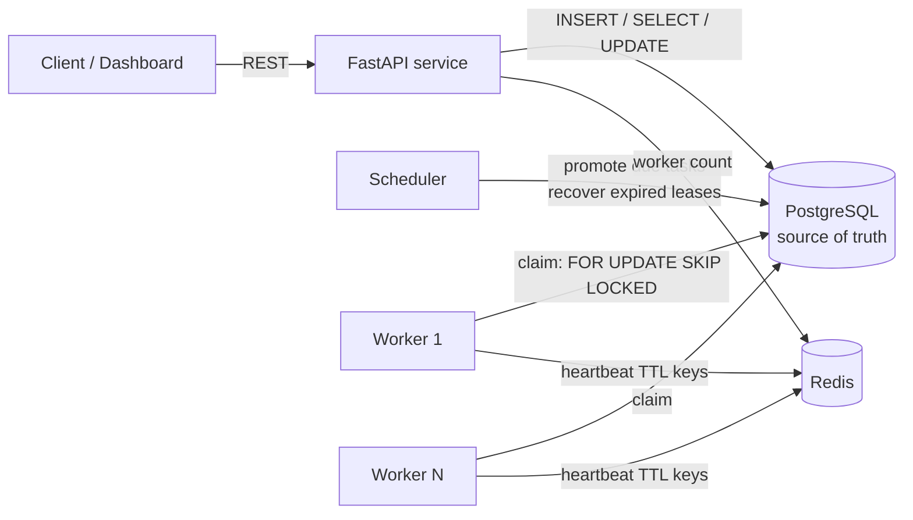

# Architecture

## Overview

## Component responsibilities

| Component  | Responsibility | State owned |
|------------|----------------|-------------|
| FastAPI    | Task submission, queries, cancel/retry, stats | none (stateless) |
| Worker     | Claims tasks, executes registered handlers, persists outcomes | none (leases in PG) |
| Scheduler  | Promotes due SCHEDULED/RETRY_WAITING rows; recovers expired leases | none |
| PostgreSQL | All task metadata, attempts, scheduling data | **source of truth** |
| Redis      | Worker heartbeats (TTL 60 s) — nothing else | transient only |

## Execution architecture decision

A **custom PostgreSQL-backed worker** was chosen over Celery/RQ:

- Celery/RQ keep the queue *in Redis*; Redis is then part of the durability
  contract. TaskMesh requires that flushing Redis never loses a task, that
  PostgreSQL hold the full status/history, and that claiming, leasing and
  recovery be auditable in one place.
- The claim loop is a single SQL statement (atomic claim), which is easy to
  reason about and to test for race conditions against a real database.
- Trade-off: no built-in cross-process rate limiting, no Celery Beat; the
  scheduler is a small custom loop. Fine for this scope.

## Key mechanisms

- **Claiming** (`repository.claim_next_task`): one `INSERT..RETURNING`-style
  CTE — `SELECT ... FOR UPDATE SKIP LOCKED LIMIT 1` then `UPDATE ... SET
  status='RUNNING', attempts=attempts+1, lease=...`. Two workers can never
  claim the same row; the loser sees it locked and skips to the next.
- **Leases**: each claim sets `leased_by` + `lease_expires_at`. The worker
  checks ownership again *before persisting outcomes*, so a task recovered
  after a crash cannot have its result double-applied by the dead worker.
- **Recovery**: the scheduler reclaims rows whose lease expired: attempt →
  FAILED ("lease expired"), task → RETRY_WAITING (or FAILED if exhausted).
- **Delivery semantics: at-least-once.** If a worker crashes after executing
  the handler but before persisting the result, recovery re-runs the task.
  Handlers must be idempotent or tolerate duplicate execution. Exactly-once
  is **not** guaranteed and this is not claimed.
- **Priority scheduling**: claim ordering is `HIGH > NORMAL > LOW`, FIFO
  within a priority. This is greedy, not fair: a continuous stream of HIGH
  tasks can starve LOW tasks. Documented as a known limitation.
- **Cancellation**: cooperative. Non-running tasks are cancelled directly;
  a RUNNING task transitions to CANCELLED in the DB, and the executing
  worker discards its result when it finds the row no longer owned by it.
  A running Python function is not force-killed (threads cannot be).
- **Idempotency**: partial unique index on `idempotency_key`; the API
  returns the existing task with `created: false`. Concurrent duplicates are
  resolved by the DB constraint (one insert wins, the other replays).

## Restart behavior

Everything durable is in PostgreSQL. Workers and the scheduler are stateless;
restarting any of them is safe at any time. Scheduled tasks and retry timers
survive restarts because they are rows, not in-memory timers.
